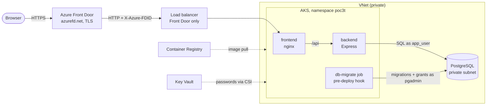
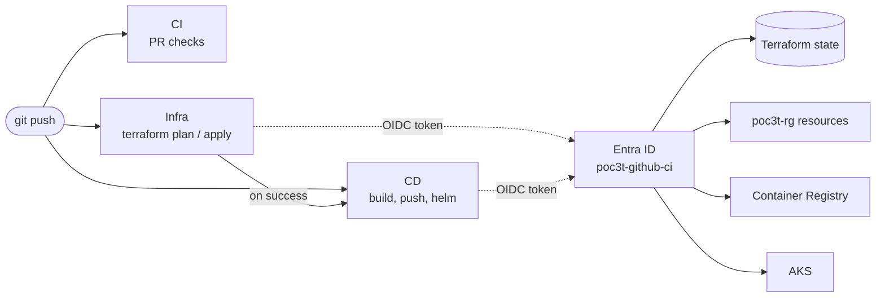

# Three-Tier PoC on Azure Kubernetes Service

A proof-of-concept three-tier web app, built and deployed to AKS by GitHub Actions.

| Tier         | Tech                            | Runs on (Azure)                          |
| ------------ | ------------------------------- | ---------------------------------------- |
| Presentation | React (Vite), served by nginx   | AKS                                      |
| Application  | Node.js / Express REST API      | AKS                                      |
| Data         | PostgreSQL                      | Azure Database for PostgreSQL (Flexible) |

## Architecture

Serving a request (solid: traffic, dotted: images and secrets):



Shipping a change:



## Repository layout

```
frontend/        React app, nginx config, Dockerfile
backend/         Express API, SQL migrations, tests, Dockerfile
infra/           Bootstrap script + Terraform for Azure (see infra/README.md)
deploy/helm/     Helm chart (frontend, backend, Key Vault secret, optional Gateway)
.github/         CI/CD workflows
docker-compose.yml   Local run of all three tiers
```

## Run locally

With Docker:

```sh
docker compose up --build
# open http://localhost:8080
```

Without Docker (needs a local Postgres):

```sh
cd backend && npm install
PGHOST=localhost PGUSER=app PGPASSWORD=app PGDATABASE=app PGSSLMODE=disable npm run dev

cd frontend && npm install && npm run dev   # http://localhost:5173, proxies /api to :3000
```

## Backend API

| Method | Path              | Purpose                                         |
| ------ | ----------------- | ----------------------------------------------- |
| GET    | `/healthz`        | Liveness probe (no DB check)                    |
| GET    | `/readyz`         | Readiness probe (checks DB)                     |
| GET    | `/api/info`       | Pod hostname + app version (shows load balancing) |
| GET    | `/api/items`      | List items                                      |
| POST   | `/api/items`      | Create item `{ "name": "..." }`                 |
| DELETE | `/api/items/:id`  | Delete item                                     |

Configuration is via environment variables: `PORT`, `APP_VERSION`, and the standard
libpq variables `PGHOST`, `PGPORT`, `PGUSER`, `PGPASSWORD`, `PGDATABASE`, `PGSSLMODE`
(use `require` for Azure Database for PostgreSQL).

Migrations in `backend/migrations/*.sql` run automatically at startup, guarded by a
Postgres advisory lock so multiple replicas can start at once safely.

```sh
cd backend && npm test
```

## CI/CD

| Workflow | Trigger | What it does |
| -------- | ------- | ------------ |
| `CI` | PRs touching app or chart | Backend tests, frontend build, Helm lint, image builds (no push) |
| `Infra` | PR / push to `main` touching `infra/terraform`, manual | PR: `terraform plan`, summary comment (addresses only). `main`: plan + apply |
| `CD` | push to `main` touching app or chart, after a successful `Infra` run, manual | Tests, then builds and pushes images tagged with the commit SHA to ACR, `helm upgrade --install`, smoke test through Front Door (or the public IP when it's disabled) |
| `Destroy` | manual, type `destroy` to confirm | `terraform destroy` of everything in `poc3t-rg` |

All Azure access uses GitHub OIDC with the `poc3t-github-ci` managed identity; there are
no Azure credentials stored in GitHub. Deploying jobs run in the `dev` environment, which
only the `main` branch can use. See [infra/README.md](infra/README.md) for the one-time
bootstrap.

## Roadmap

1. ✅ App scaffold + local docker-compose
2. ✅ Terraform: VNet, ACR, AKS, PostgreSQL Flexible Server (private), Key Vault, GitHub OIDC bootstrap
3. ✅ Helm chart: deployments, services, LoadBalancer (or Gateway API), probes, Key Vault secrets
4. ✅ GitHub Actions: CI (test/build), CD (push to ACR, `helm upgrade`), infra (plan/apply), destroy
5. End-to-end verification and teardown
